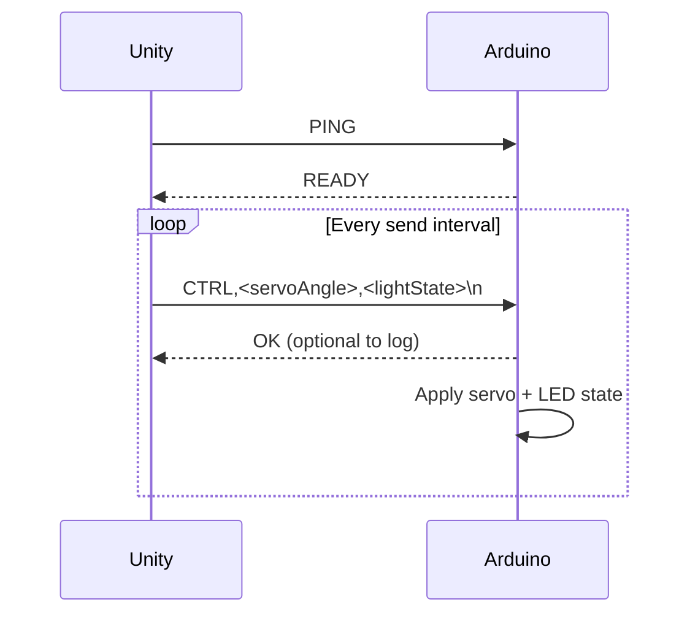
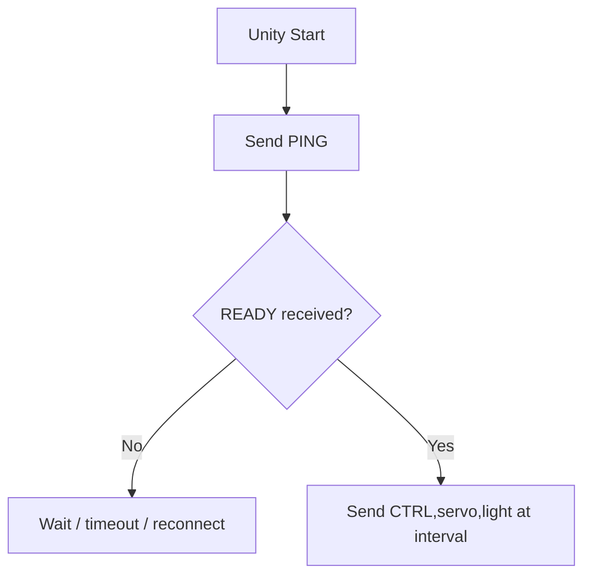
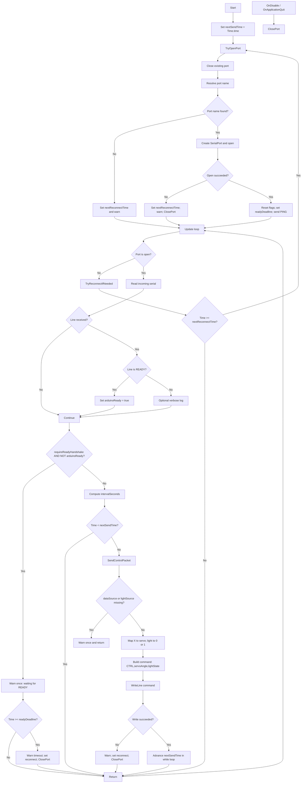
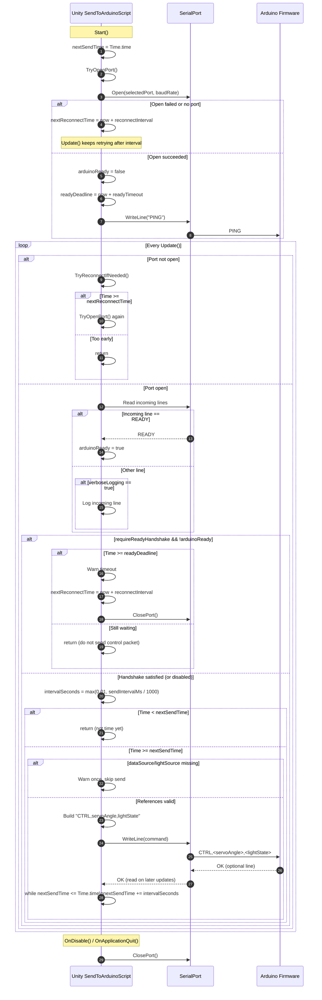

# GitHub Copilot Chat Transcript

**Conversation:** 19 exchanges  
**Source:** VS Code GitHub Copilot JSON export  
**Formatting:** Original message content preserved; internal thinking, tool invocation records, and telemetry omitted.

## Exchange 1 — October 14, 2026, 5:36:17 PM MST

### User

If I wanted to add a max value for this, what would the syntax be for that?

[Min(10)] public int sendIntervalMs = 50;

### GitHub Copilot

In Unity, the usual way is to replace `Min` with `Range`:

```csharp
[Range(10, 1000)] public int sendIntervalMs = 50;
```

That gives you both a min and max in the Inspector.

Two quick notes:

- `Range` shows a slider (for `int`/`float`) in the Inspector.
- If you also want to enforce clamping in code (not just Inspector editing), add an `OnValidate()` clamp too.

---

## Exchange 2 — October 14, 2026, 5:40:28 PM MST

### User

Explain line 37

### GitHub Copilot

Line 37:

```csharp
nextSendTime = Time.time;
```

sets `nextSendTime` to the **current game time** (in seconds since the scene/game started).

So practically, it means: “the next allowed send time is now.”  
If your later logic is something like `if (Time.time >= nextSendTime)`, this makes the send eligible immediately (usually this frame or next frame).

Reference: [SendToArduinoScript.cs:37](/Users/blahey/ASU/Teaching/DigitalPhysicalSystems/Courses/Fall2026/Projects/UnityArduinoTesting/VirtualToPhysical01-main/Assets/Scripts/SendToArduinoScript.cs:37)

---

## Exchange 3 — October 14, 2026, 5:42:31 PM MST

### User

How is "nextSendTime" used in this code in general?

### GitHub Copilot

I’ll quickly inspect the script so I can explain exactly how `nextSendTime` is used end-to-end.

Great question. In this script, `nextSendTime` is the **send-rate scheduler**.

### How it’s used overall

- It’s declared as a private timer field: [nextSendTime](/Users/blahey/ASU/Teaching/DigitalPhysicalSystems/Courses/Fall2026/Projects/UnityArduinoTesting/VirtualToPhysical01-main/Assets/Scripts/SendToArduinoScript.cs:26)
- It’s initialized in `Start()` to “now”: [Start](/Users/blahey/ASU/Teaching/DigitalPhysicalSystems/Courses/Fall2026/Projects/UnityArduinoTesting/VirtualToPhysical01-main/Assets/Scripts/SendToArduinoScript.cs:33)
- In `Update()`, the script computes the desired interval from `sendIntervalMs`, then checks:
  - if `Time.time < nextSendTime`, it **does not send yet** ([Update](/Users/blahey/ASU/Teaching/DigitalPhysicalSystems/Courses/Fall2026/Projects/UnityArduinoTesting/VirtualToPhysical01-main/Assets/Scripts/SendToArduinoScript.cs:67))
  - once `Time.time >= nextSendTime`, it sends one packet ([SendControlPacket](/Users/blahey/ASU/Teaching/DigitalPhysicalSystems/Courses/Fall2026/Projects/UnityArduinoTesting/VirtualToPhysical01-main/Assets/Scripts/SendToArduinoScript.cs:72))
- After sending, it advances `nextSendTime` in a loop by `intervalSeconds` until it’s in the future ([while loop](/Users/blahey/ASU/Teaching/DigitalPhysicalSystems/Courses/Fall2026/Projects/UnityArduinoTesting/VirtualToPhysical01-main/Assets/Scripts/SendToArduinoScript.cs:75)).

### Why this is useful

It keeps sending at a steady cadence (e.g., every 50 ms) **independent of frame rate**.  
If one frame is late, the `while` loop catches the schedule up so timing stays stable rather than drifting.

---

## Exchange 4 — October 14, 2026, 5:46:41 PM MST

### User

Explain line 51. I'm confused about why "arduinoReady" has the !(not) operator.

### GitHub Copilot

I’ll grab the exact surrounding lines so I can explain line 51 precisely.

Totally fair confusion — this line is a boolean gate:

```csharp
if (requireReadyHandshake && !arduinoReady)
```

At [SendToArduinoScript.cs:51](/Users/blahey/ASU/Teaching/DigitalPhysicalSystems/Courses/Fall2026/Projects/UnityArduinoTesting/VirtualToPhysical01-main/Assets/Scripts/SendToArduinoScript.cs:51), it means:

- `requireReadyHandshake` = “Do we care about handshake?”
- `!arduinoReady` = “Arduino is **not** ready yet”

So the block runs only when both are true:
1. Handshake is required, **and**
2. READY has not been received yet.

### Why the `!` is needed
`arduinoReady` becomes `true` after receiving `"READY"`.  
Until then, it’s `false`.  
Using `!arduinoReady` checks that “not ready” state, so the script waits/logs/timeout-handles instead of sending control packets too early.

If it were just `arduinoReady` (without `!`), it would do this waiting logic only after the Arduino is ready — the opposite of what you want.

---

## Exchange 5 — October 14, 2026, 5:52:19 PM MST

### User

Where is the value for "readyDeadline" assigned (before the conditional in line 59)?

### GitHub Copilot

I’ll locate every assignment to `readyDeadline` so we can trace exactly where it’s set before that check.

It’s assigned in `TryOpenPort()` here:

- [SendToArduinoScript.cs:138](/Users/blahey/ASU/Teaching/DigitalPhysicalSystems/Courses/Fall2026/Projects/UnityArduinoTesting/VirtualToPhysical01-main/Assets/Scripts/SendToArduinoScript.cs:138)

```csharp
readyDeadline = Time.time + readyTimeoutSeconds;
```

So before the timeout check on line 59, the flow is:

1. `Start()` calls `TryOpenPort()` ([SendToArduinoScript.cs:34](/Users/blahey/ASU/Teaching/DigitalPhysicalSystems/Courses/Fall2026/Projects/UnityArduinoTesting/VirtualToPhysical01-main/Assets/Scripts/SendToArduinoScript.cs:34))
2. After opening the port, `TryOpenPort()` sets `readyDeadline` to “now + timeout”.
3. `Update()` later checks whether `Time.time >= readyDeadline` while waiting for READY.

It also gets reset again each time a reconnect successfully opens the port (same line in `TryOpenPort()`).

---

## Exchange 6 — October 14, 2026, 5:57:29 PM MST

### User

Explain lines 69 and 70

### GitHub Copilot

Sure — these two lines work together to control **send timing**.

At [SendToArduinoScript.cs:69](/Users/blahey/ASU/Teaching/DigitalPhysicalSystems/Courses/Fall2026/Projects/UnityArduinoTesting/VirtualToPhysical01-main/Assets/Scripts/SendToArduinoScript.cs:69):

```csharp
float intervalSeconds = Mathf.Max(0.01f, sendIntervalMs / 1000f);
```

- Converts `sendIntervalMs` (milliseconds) to seconds.
  - Example: `50 ms` → `0.05 s`
- `Mathf.Max(0.01f, ...)` enforces a minimum interval of 0.01s (10 ms), so it can’t become zero or extremely tiny.

At [SendToArduinoScript.cs:70](/Users/blahey/ASU/Teaching/DigitalPhysicalSystems/Courses/Fall2026/Projects/UnityArduinoTesting/VirtualToPhysical01-main/Assets/Scripts/SendToArduinoScript.cs:70):

```csharp
if (Time.time < nextSendTime)
```

- Checks whether it’s **too early** to send again.
- If current game time is still before the scheduled `nextSendTime`, the method returns and skips sending this frame.

So in plain terms: line 69 decides *how often* sends are allowed, and line 70 enforces that schedule.

---

## Exchange 7 — October 14, 2026, 5:59:01 PM MST

### User

Why is the timing managed in seconds rather than in milliseconds? This conversion just seems like an added complexity. Don't change anything.

### GitHub Copilot

Great question — your instinct is reasonable.

The main reason is: Unity’s built-in clock values (`Time.time`, `Time.deltaTime`) are already in **seconds**.  
So in [SendToArduinoScript.cs:69-70](/Users/blahey/ASU/Teaching/DigitalPhysicalSystems/Courses/Fall2026/Projects/UnityArduinoTesting/VirtualToPhysical01-main/Assets/Scripts/SendToArduinoScript.cs:69), the code converts once so everything compares in the same unit as `Time.time`.

Why that’s typically preferred:

- **Consistency with Unity API**: no repeated `* 1000` / `/ 1000` everywhere.
- **Fewer unit-mismatch bugs**: comparing milliseconds directly to `Time.time` (seconds) is an easy mistake.
- **Readability for time math in Unity**: most Unity timing code is “seconds-based.”

So yes, there is a conversion step, but it usually *reduces* complexity overall because all runtime timing stays in the engine’s native unit. The script still exposes `sendIntervalMs` in ms because that can feel more intuitive in the Inspector for short intervals like 50 ms.

---

## Exchange 8 — October 14, 2026, 6:08:13 PM MST

### User

Explain line 239. I'm specifically interested in how the CTRL component is utilized.

### GitHub Copilot

I’ll quickly check where `CTRL` appears across the project so I can explain exactly how it’s used end-to-end.

Great focus point.

At [SendToArduinoScript.cs:239](/Users/blahey/ASU/Teaching/DigitalPhysicalSystems/Courses/Fall2026/Projects/UnityArduinoTesting/VirtualToPhysical01-main/Assets/Scripts/SendToArduinoScript.cs:239):

```csharp
string command = "CTRL," + servoAngle + "," + lightState;
```

this builds a serial message like:

- `CTRL,90,0`
- `CTRL,135,1`

### What `CTRL` does
`CTRL` is a **command prefix / message type tag**.  
It tells the Arduino: “this line is a control command with `servoAngle` and `lightState` fields.”

On the Arduino side, it’s explicitly parsed with this pattern:

- [UnityDataDrivenActuators.ino:42](/Users/blahey/ASU/Teaching/DigitalPhysicalSystems/Courses/Fall2026/Projects/UnityArduinoTesting/VirtualToPhysical01-main/Firmware/UnityDataDrivenActuators/UnityDataDrivenActuators.ino:42)

```cpp
sscanf(line, "CTRL,%d,%d", &parsedServo, &parsedLight)
```

So `CTRL` is not just decoration—it’s part of the expected protocol format. It helps the receiver recognize the packet shape before extracting values.

---

## Exchange 9 — October 14, 2026, 6:10:33 PM MST

### User

Does this code send data other than control commands? I assume there are messages that are part of the handshake

### GitHub Copilot

I’ll quickly verify all serial writes in the script so I can answer precisely about handshake vs control messages.

Yes — good assumption. It sends **one non-control message** for handshake:

- `PING` during connection setup: [SendToArduinoScript.cs:139](/Users/blahey/ASU/Teaching/DigitalPhysicalSystems/Courses/Fall2026/Projects/UnityArduinoTesting/VirtualToPhysical01-main/Assets/Scripts/SendToArduinoScript.cs:139)
- `CTRL,...` during normal operation: [SendToArduinoScript.cs:239](/Users/blahey/ASU/Teaching/DigitalPhysicalSystems/Courses/Fall2026/Projects/UnityArduinoTesting/VirtualToPhysical01-main/Assets/Scripts/SendToArduinoScript.cs:239), sent at [SendToArduinoScript.cs:243](/Users/blahey/ASU/Teaching/DigitalPhysicalSystems/Courses/Fall2026/Projects/UnityArduinoTesting/VirtualToPhysical01-main/Assets/Scripts/SendToArduinoScript.cs:243)

And on the receive side, Unity waits for Arduino to reply with `READY` (Unity reads this; it does not send `READY`): [SendToArduinoScript.cs:166](/Users/blahey/ASU/Teaching/DigitalPhysicalSystems/Courses/Fall2026/Projects/UnityArduinoTesting/VirtualToPhysical01-main/Assets/Scripts/SendToArduinoScript.cs:166), [SendToArduinoScript.cs:170](/Users/blahey/ASU/Teaching/DigitalPhysicalSystems/Courses/Fall2026/Projects/UnityArduinoTesting/VirtualToPhysical01-main/Assets/Scripts/SendToArduinoScript.cs:170).

So outgoing traffic is basically:
1) `PING` (handshake ping), then  
2) repeated `CTRL,servo,light` commands.

---

## Exchange 10 — October 15, 2026, 9:48:01 AM MST

### User

Can you produce a diagram that illustrates the logical flow of this system?

### GitHub Copilot

I can—I'll quickly read the Arduino sketch around setup/loop so the diagram reflects the full Unity↔Arduino flow accurately.

Absolutely—here’s a diagram of the logical flow between Unity and Arduino based on [SendToArduinoScript.cs](/Users/blahey/ASU/Teaching/DigitalPhysicalSystems/Courses/Fall2026/Projects/UnityArduinoTesting/VirtualToPhysical01-main/Assets/Scripts/SendToArduinoScript.cs) and [UnityDataDrivenActuators.ino](/Users/blahey/ASU/Teaching/DigitalPhysicalSystems/Courses/Fall2026/Projects/UnityArduinoTesting/VirtualToPhysical01-main/Firmware/UnityDataDrivenActuators/UnityDataDrivenActuators.ino).

```mermaid
flowchart TD
    A[Unity Start] --> B[Set nextSendTime = Time.time]
    B --> C[TryOpenPort()]
    C -->|Open success| D[Set arduinoReady=false<br/>readyDeadline=now+timeout<br/>Send PING]
    C -->|Open fail / no ports| E[Set nextReconnectTime]
    E --> F[Update loop waits until reconnect interval]
    F --> C

    D --> G[Update loop]
    G --> H{Port open?}
    H -->|No| F
    H -->|Yes| I[ReadIncomingSerialMessages]

    I --> J{Received READY?}
    J -->|Yes| K[arduinoReady = true]
    J -->|No| L[keep current state]

    K --> M{Handshake required AND !arduinoReady?}
    L --> M

    M -->|Yes| N{Time.time >= readyDeadline?}
    N -->|No| O[Wait / warn once]
    N -->|Yes| P[ClosePort + schedule reconnect]
    O --> G
    P --> F

    M -->|No| Q[Compute intervalSeconds = max 0.01, sendIntervalMs/1000]
    Q --> R{Time.time < nextSendTime?}
    R -->|Yes| G
    R -->|No| S[SendControlPacket: CTRL,servoAngle,lightState]
    S --> T[Advance nextSendTime by interval in while-loop]
    T --> G
```

And the serial protocol message flow:



If you want, I can also generate a **simplified “teaching version”** (5–6 boxes) for slides.

---

## Exchange 11 — October 15, 2026, 11:06:45 AM MST

### User

Please produce a diagram that explains the logical flow of the SendToArduino script. This should include logical paths for the conditional tests.

### GitHub Copilot

Absolutely — here’s a focused logic-flow diagram for [SendToArduinoScript.cs](/Users/blahey/ASU/Teaching/DigitalPhysicalSystems/Courses/Fall2026/Projects/UnityArduinoTesting/VirtualToPhysical01-main/Assets/Scripts/SendToArduinoScript.cs), including the conditional branches.

```mermaid
flowchart TD
    A[Start()] --> B[nextSendTime = Time.time]
    B --> C[TryOpenPort()]

    C --> D[ClosePort() first]
    D --> E[ResolvePortName()]

    E --> F{selectedPort is empty?}
    F -->|Yes| F1[Set nextReconnectTime = now + reconnectIntervalSeconds<br/>Warn: no ports<br/>Return]
    F -->|No| G[Attempt SerialPort open/configure]

    G --> H{Open succeeded?}
    H -->|No (Exception)| H1[Set nextReconnectTime<br/>Warn open failed<br/>ClosePort()<br/>Return]
    H -->|Yes| I[Discard buffers<br/>arduinoReady=false<br/>hasWarnedWaitingForReady=false<br/>readyDeadline=now+readyTimeoutSeconds<br/>WriteLine('PING')]

    %% Update loop
    I --> U[Update()]
    F1 --> U
    H1 --> U

    U --> J{IsPortOpen()?}
    J -->|No| K[TryReconnectIfNeeded()]
    K --> K1{Time.time < nextReconnectTime?}
    K1 -->|Yes| UEND[Return]
    K1 -->|No| C
    J -->|Yes| L[ReadIncomingSerialMessages()]

    %% Incoming reads
    L --> M{Read line available?}
    M -->|No| N[Continue Update]
    M -->|Yes| M1{line == 'READY'?}
    M1 -->|Yes| M2[arduinoReady = true]
    M1 -->|No| M3{verboseLogging?}
    M3 -->|Yes| M4[Log line]
    M3 -->|No| N
    M2 --> N
    M4 --> N

    %% Handshake gate
    N --> O{requireReadyHandshake && !arduinoReady?}
    O -->|Yes| P{hasWarnedWaitingForReady?}
    P -->|No| P1[Warn waiting for READY<br/>hasWarnedWaitingForReady=true]
    P -->|Yes| Q
    P1 --> Q
    Q{Time.time >= readyDeadline?}
    Q -->|Yes| Q1[Warn timeout<br/>nextReconnectTime = now + reconnectIntervalSeconds<br/>ClosePort()<br/>Return]
    Q -->|No| UEND
    O -->|No| R[intervalSeconds = max(0.01, sendIntervalMs/1000)]

    %% Send cadence gate
    R --> S{Time.time < nextSendTime?}
    S -->|Yes| UEND
    S -->|No| T[SendControlPacket()]

    %% Send control packet internals
    T --> V{dataSource == null OR lightSource == null?}
    V -->|Yes| V1{hasWarnedMissingReferences?}
    V1 -->|No| V2[Warn missing refs<br/>hasWarnedMissingReferences=true<br/>Return]
    V1 -->|Yes| UEND
    V -->|No| W[hasWarnedMissingReferences=false<br/>servoAngle = MapXToServoAngle(dataSource.x)<br/>lightState = lightSource.enabled?1:0<br/>command='CTRL,servo,light']

    W --> X{serial write succeeds?}
    X -->|No (Exception)| X1[Warn write failed<br/>nextReconnectTime = now + reconnectIntervalSeconds<br/>ClosePort()]
    X -->|Yes| Y{verboseLogging?}
    Y -->|Yes| Y1[Log Sent command]
    Y -->|No| Z

    Y1 --> Z[while nextSendTime <= Time.time: nextSendTime += intervalSeconds]
    X1 --> UEND
    Z --> UEND

    %% shutdown
    AA[OnDisable / OnApplicationQuit] --> AB[ClosePort()]
```

### Quick interpretation of the major conditional paths

- **Connection path**: if port isn’t open, it retries only after `nextReconnectTime`.
- **Handshake path**: if handshake is required and `READY` hasn’t arrived, sending is blocked; timeout forces reconnect.
- **Cadence path**: even when ready, sending only happens when `Time.time >= nextSendTime`.
- **Safety path**: missing Unity references skip send and warn once.
- **Recovery path**: read/write/open exceptions close the port and schedule reconnect.

If you want, I can also provide a **condensed classroom version** with just 8–10 nodes.

---

## Exchange 12 — October 15, 2026, 11:07:47 AM MST

### User

Please produce a mermaid diagram for this.

### GitHub Copilot

```mermaid
flowchart TD
    A[Start] --> B[nextSendTime = Time.time]
    B --> C[TryOpenPort]
    C --> D{Port opened?}
    D -->|No| E[Set nextReconnectTime and retry later]
    D -->|Yes| F[Set arduinoReady=false; readyDeadline=now+timeout; send PING]

    F --> G[Update loop]
    E --> G

    G --> H{Port open?}
    H -->|No| I{Time.time >= nextReconnectTime?}
    I -->|No| G
    I -->|Yes| C
    H -->|Yes| J[ReadIncomingSerialMessages]

    J --> K{Received READY?}
    K -->|Yes| L[arduinoReady=true]
    K -->|No| M[No readiness change]

    L --> N{requireReadyHandshake AND !arduinoReady?}
    M --> N

    N -->|Yes| O{Time.time >= readyDeadline?}
    O -->|No| P[Wait for READY; skip sending this frame]
    O -->|Yes| Q[Close port; schedule reconnect]
    P --> G
    Q --> G

    N -->|No| R[intervalSeconds = max(0.01, sendIntervalMs/1000)]
    R --> S{Time.time < nextSendTime?}
    S -->|Yes| G
    S -->|No| T[Build command: CTRL,servoAngle,lightState]

    T --> U[WriteLine(command)]
    U --> V{Write succeeded?}
    V -->|No| W[Warn; close port; schedule reconnect]
    V -->|Yes| X[Advance nextSendTime in while loop]
    W --> G
    X --> G
```

---

## Exchange 13 — October 15, 2026, 11:08:59 AM MST

### User

I don't see the diagram. Is it working?

### GitHub Copilot

Yep—it’s likely fine, but your current chat/IDE renderer may not auto-render Mermaid blocks in-place.

### Quick checks
1. Make sure the block starts with exactly:
   ````
   ```mermaid
   ````
   and ends with:
   ````
   ```
   ````
2. Paste it into a Mermaid-capable viewer:
   - https://mermaid.live
   - or a Markdown preview extension that supports Mermaid

### If helpful, here’s a very small test diagram
Paste this first to confirm rendering:



If this test renders, I can send a cleaned “final” full version optimized for your specific renderer (some require simpler labels).

---

## Exchange 14 — October 15, 2026, 11:11:04 AM MST

### User

Yes that worked. Please produce the full version

### GitHub Copilot

Awesome—great. Here’s the full Mermaid version with simplified labels for better compatibility:



If you want, I can also provide this as a **sequence diagram** (Unity ↔ Arduino messages over time), which is often easier for protocol explanations.

---

## Exchange 15 — October 15, 2026, 11:32:08 AM MST

### User

Yes, please produce a sequence diagram.

### GitHub Copilot

Great idea—here’s a full Mermaid **sequence diagram** for the script behavior, including handshake, timed sending, and reconnect paths:



If you want, I can also provide a **minimal version** (about 12–15 lines) for lecture slides.

---

## Exchange 16 — October 15, 2026, 11:33:51 AM MST

### User

Please add callouts to this that indicate where in the code these logical operations occur.

### GitHub Copilot

Perfect—I'll map each sequence step to exact line callouts from the script so you can paste a code-referenced version directly.

Absolutely — here’s the sequence diagram with **callout IDs** embedded, followed by a legend mapping each callout to exact code lines in [SendToArduinoScript.cs](/Users/blahey/ASU/Teaching/DigitalPhysicalSystems/Courses/Fall2026/Projects/UnityArduinoTesting/VirtualToPhysical01-main/Assets/Scripts/SendToArduinoScript.cs).

```mermaid
sequenceDiagram
    autonumber
    participant U as Unity SendToArduinoScript
    participant S as SerialPort
    participant A as Arduino Firmware

    Note over U: C1 Start + initialize send timer
    U->>U: nextSendTime = Time.time
    U->>U: TryOpenPort()

    Note over U: C2 TryOpenPort connection attempt
    U->>S: Open(selectedPort, baudRate)

    alt Open failed / no port
        Note over U: C3 Schedule reconnect
        U->>U: nextReconnectTime = now + reconnectInterval
    else Open succeeded
        Note over U: C4 Init handshake state + send PING
        U->>U: arduinoReady = false
        U->>U: readyDeadline = now + readyTimeout
        U->>S: WriteLine("PING")
        S->>A: PING
    end

    loop Every Update()
        Note over U: C5 Port-open gate
        alt Port not open
            U->>U: TryReconnectIfNeeded()
            alt Time >= nextReconnectTime
                U->>U: TryOpenPort() again
            else Too early to reconnect
                U->>U: return
            end
        else Port open
            Note over U: C6 Read incoming lines
            U->>S: ReadIncomingSerialMessages()

            alt Incoming line is READY
                Note over U: C7 Mark ready
                S-->>U: READY
                U->>U: arduinoReady = true
            else Other incoming line
                U->>U: optional verbose log
            end

            Note over U: C8 Handshake gate
            alt requireReadyHandshake && !arduinoReady
                alt Time >= readyDeadline
                    Note over U: C9 Handshake timeout path
                    U->>U: nextReconnectTime = now + reconnectInterval
                    U->>S: ClosePort()
                else Waiting for READY
                    U->>U: return (skip sending)
                end
            else Handshake satisfied (or disabled)
                Note over U: C10 Interval gate
                U->>U: intervalSeconds = max(0.01, sendIntervalMs/1000)
                alt Time < nextSendTime
                    U->>U: return
                else Time >= nextSendTime
                    Note over U: C11 Build + send CTRL packet
                    alt Missing dataSource/lightSource
                        U->>U: warn once; return
                    else Inputs valid
                        U->>U: command = "CTRL,servoAngle,lightState"
                        U->>S: WriteLine(command)
                        S->>A: CTRL,<servoAngle>,<lightState>
                    end

                    Note over U: C12 Keep steady send cadence
                    U->>U: while nextSendTime <= Time.time\nnextSendTime += intervalSeconds
                end
            end
        end
    end

    Note over U: C13 Shutdown cleanup
    U->>S: ClosePort()
```

### Callout legend (code locations)

- **C1**: `Start`, initialize timer, call open  
  [Start](/Users/blahey/ASU/Teaching/DigitalPhysicalSystems/Courses/Fall2026/Projects/UnityArduinoTesting/VirtualToPhysical01-main/Assets/Scripts/SendToArduinoScript.cs:35), [nextSendTime assignment](/Users/blahey/ASU/Teaching/DigitalPhysicalSystems/Courses/Fall2026/Projects/UnityArduinoTesting/VirtualToPhysical01-main/Assets/Scripts/SendToArduinoScript.cs:37), [TryOpenPort call](/Users/blahey/ASU/Teaching/DigitalPhysicalSystems/Courses/Fall2026/Projects/UnityArduinoTesting/VirtualToPhysical01-main/Assets/Scripts/SendToArduinoScript.cs:38)

- **C2**: `TryOpenPort`, open attempt  
  [TryOpenPort](/Users/blahey/ASU/Teaching/DigitalPhysicalSystems/Courses/Fall2026/Projects/UnityArduinoTesting/VirtualToPhysical01-main/Assets/Scripts/SendToArduinoScript.cs:109), [SerialPort ctor](/Users/blahey/ASU/Teaching/DigitalPhysicalSystems/Courses/Fall2026/Projects/UnityArduinoTesting/VirtualToPhysical01-main/Assets/Scripts/SendToArduinoScript.cs:123), [Open](/Users/blahey/ASU/Teaching/DigitalPhysicalSystems/Courses/Fall2026/Projects/UnityArduinoTesting/VirtualToPhysical01-main/Assets/Scripts/SendToArduinoScript.cs:132)

- **C3**: reconnect scheduling on failure/no port  
  [No port branch](/Users/blahey/ASU/Teaching/DigitalPhysicalSystems/Courses/Fall2026/Projects/UnityArduinoTesting/VirtualToPhysical01-main/Assets/Scripts/SendToArduinoScript.cs:114), [set nextReconnectTime](/Users/blahey/ASU/Teaching/DigitalPhysicalSystems/Courses/Fall2026/Projects/UnityArduinoTesting/VirtualToPhysical01-main/Assets/Scripts/SendToArduinoScript.cs:116), [open exception catch](/Users/blahey/ASU/Teaching/DigitalPhysicalSystems/Courses/Fall2026/Projects/UnityArduinoTesting/VirtualToPhysical01-main/Assets/Scripts/SendToArduinoScript.cs:144)

- **C4**: handshake initialization + ping send  
  [arduinoReady reset](/Users/blahey/ASU/Teaching/DigitalPhysicalSystems/Courses/Fall2026/Projects/UnityArduinoTesting/VirtualToPhysical01-main/Assets/Scripts/SendToArduinoScript.cs:136), [readyDeadline set](/Users/blahey/ASU/Teaching/DigitalPhysicalSystems/Courses/Fall2026/Projects/UnityArduinoTesting/VirtualToPhysical01-main/Assets/Scripts/SendToArduinoScript.cs:138), [WriteLine("PING")](/Users/blahey/ASU/Teaching/DigitalPhysicalSystems/Courses/Fall2026/Projects/UnityArduinoTesting/VirtualToPhysical01-main/Assets/Scripts/SendToArduinoScript.cs:139)

- **C5**: update port-open gate + reconnect check  
  [Update](/Users/blahey/ASU/Teaching/DigitalPhysicalSystems/Courses/Fall2026/Projects/UnityArduinoTesting/VirtualToPhysical01-main/Assets/Scripts/SendToArduinoScript.cs:41), [if !IsPortOpen](/Users/blahey/ASU/Teaching/DigitalPhysicalSystems/Courses/Fall2026/Projects/UnityArduinoTesting/VirtualToPhysical01-main/Assets/Scripts/SendToArduinoScript.cs:43), [TryReconnectIfNeeded](/Users/blahey/ASU/Teaching/DigitalPhysicalSystems/Courses/Fall2026/Projects/UnityArduinoTesting/VirtualToPhysical01-main/Assets/Scripts/SendToArduinoScript.cs:99)

- **C6**: incoming serial read path  
  [ReadIncomingSerialMessages call](/Users/blahey/ASU/Teaching/DigitalPhysicalSystems/Courses/Fall2026/Projects/UnityArduinoTesting/VirtualToPhysical01-main/Assets/Scripts/SendToArduinoScript.cs:49), [method](/Users/blahey/ASU/Teaching/DigitalPhysicalSystems/Courses/Fall2026/Projects/UnityArduinoTesting/VirtualToPhysical01-main/Assets/Scripts/SendToArduinoScript.cs:153)

- **C7**: READY detection and readiness set  
  [READY check](/Users/blahey/ASU/Teaching/DigitalPhysicalSystems/Courses/Fall2026/Projects/UnityArduinoTesting/VirtualToPhysical01-main/Assets/Scripts/SendToArduinoScript.cs:171), [arduinoReady=true](/Users/blahey/ASU/Teaching/DigitalPhysicalSystems/Courses/Fall2026/Projects/UnityArduinoTesting/VirtualToPhysical01-main/Assets/Scripts/SendToArduinoScript.cs:173)

- **C8**: handshake gate condition  
  [requireReadyHandshake && !arduinoReady](/Users/blahey/ASU/Teaching/DigitalPhysicalSystems/Courses/Fall2026/Projects/UnityArduinoTesting/VirtualToPhysical01-main/Assets/Scripts/SendToArduinoScript.cs:51)

- **C9**: handshake timeout + reconnect path  
  [timeout check](/Users/blahey/ASU/Teaching/DigitalPhysicalSystems/Courses/Fall2026/Projects/UnityArduinoTesting/VirtualToPhysical01-main/Assets/Scripts/SendToArduinoScript.cs:59), [set reconnect time](/Users/blahey/ASU/Teaching/DigitalPhysicalSystems/Courses/Fall2026/Projects/UnityArduinoTesting/VirtualToPhysical01-main/Assets/Scripts/SendToArduinoScript.cs:62), [ClosePort](/Users/blahey/ASU/Teaching/DigitalPhysicalSystems/Courses/Fall2026/Projects/UnityArduinoTesting/VirtualToPhysical01-main/Assets/Scripts/SendToArduinoScript.cs:63)

- **C10**: send-interval gating  
  [intervalSeconds calc](/Users/blahey/ASU/Teaching/DigitalPhysicalSystems/Courses/Fall2026/Projects/UnityArduinoTesting/VirtualToPhysical01-main/Assets/Scripts/SendToArduinoScript.cs:69), [nextSendTime check](/Users/blahey/ASU/Teaching/DigitalPhysicalSystems/Courses/Fall2026/Projects/UnityArduinoTesting/VirtualToPhysical01-main/Assets/Scripts/SendToArduinoScript.cs:70)

- **C11**: control packet build + write  
  [SendControlPacket](/Users/blahey/ASU/Teaching/DigitalPhysicalSystems/Courses/Fall2026/Projects/UnityArduinoTesting/VirtualToPhysical01-main/Assets/Scripts/SendToArduinoScript.cs:222), [missing refs check](/Users/blahey/ASU/Teaching/DigitalPhysicalSystems/Courses/Fall2026/Projects/UnityArduinoTesting/VirtualToPhysical01-main/Assets/Scripts/SendToArduinoScript.cs:224), [CTRL string build](/Users/blahey/ASU/Teaching/DigitalPhysicalSystems/Courses/Fall2026/Projects/UnityArduinoTesting/VirtualToPhysical01-main/Assets/Scripts/SendToArduinoScript.cs:239), [WriteLine(command)](/Users/blahey/ASU/Teaching/DigitalPhysicalSystems/Courses/Fall2026/Projects/UnityArduinoTesting/VirtualToPhysical01-main/Assets/Scripts/SendToArduinoScript.cs:243)

- **C12**: cadence catch-up loop  
  [while nextSendTime <= Time.time](/Users/blahey/ASU/Teaching/DigitalPhysicalSystems/Courses/Fall2026/Projects/UnityArduinoTesting/VirtualToPhysical01-main/Assets/Scripts/SendToArduinoScript.cs:78)

- **C13**: shutdown cleanup  
  [OnDisable](/Users/blahey/ASU/Teaching/DigitalPhysicalSystems/Courses/Fall2026/Projects/UnityArduinoTesting/VirtualToPhysical01-main/Assets/Scripts/SendToArduinoScript.cs:84), [OnApplicationQuit](/Users/blahey/ASU/Teaching/DigitalPhysicalSystems/Courses/Fall2026/Projects/UnityArduinoTesting/VirtualToPhysical01-main/Assets/Scripts/SendToArduinoScript.cs:89), [ClosePort](/Users/blahey/ASU/Teaching/DigitalPhysicalSystems/Courses/Fall2026/Projects/UnityArduinoTesting/VirtualToPhysical01-main/Assets/Scripts/SendToArduinoScript.cs:269)

If you want, I can also generate a **compact slide version** (same callouts, fewer branches) for classroom presentation.

---

## Exchange 17 — October 20, 2026, 9:57:29 AM MST

### User

Please explain line 42 in UnityDataDrivenActuators.ino

### GitHub Copilot

Line 42 is this condition:

```cpp
if (sscanf(line, "CTRL,%d,%d", &parsedServo, &parsedLight) == 2)
```

It means:

- Try to parse the incoming text `line` using the format:
  - literal `"CTRL,"`
  - then an integer (`%d`) → store in `parsedServo`
  - then a comma
  - then another integer (`%d`) → store in `parsedLight`
- `sscanf(...)` returns how many values it successfully parsed.
- `== 2` means both integers were parsed correctly, so the command is valid.

So this accepts commands like:

- `CTRL,90,0`
- `CTRL,135,1`

and rejects lines that don’t match that exact shape.

Reference: [UnityDataDrivenActuators.ino:42](/Users/blahey/ASU/Teaching/DigitalPhysicalSystems/Courses/Fall2026/Projects/UnityArduinoTesting/VirtualToPhysical01-main/Firmware/UnityDataDrivenActuators/UnityDataDrivenActuators.ino:42)

---

## Exchange 18 — October 20, 2026, 9:58:40 AM MST

### User

Tell me more about how sscanf works.

### GitHub Copilot

Great question—`sscanf` is super useful in embedded C/C++.

## What `sscanf` is

`sscanf` = **string scan formatted**.

It reads data **from a C string** (char array) using a format pattern, similar to how `printf` writes formatted output.

General shape:

```c
int n = sscanf(inputString, "format", &out1, &out2, ...);
```

- `inputString`: text to parse
- `"format"`: pattern you expect
- `&outX`: addresses of variables where parsed values go
- return value `n`: number of successfully assigned fields

---

## Your specific line

```cpp
sscanf(line, "CTRL,%d,%d", &parsedServo, &parsedLight)
```

Means:

- Expect literal `CTRL,`
- Read first integer into `parsedServo`
- Expect comma
- Read second integer into `parsedLight`

If both integers are read, return value is `2`.

---

## Key behavior details

### 1) Literal text in format must match exactly
`"CTRL,"` has to appear in the input at that position.

- `"CTRL,120,1"` ✅ matches
- `"ctrl,120,1"` ❌ fails (case-sensitive)
- `"PING"` ❌ fails

---

### 2) Conversion specifiers parse typed values
Common ones:

- `%d` → `int`
- `%f` → `float` (for `scanf` family this expects `float*` with `sscanf`? Actually `%f` in `sscanf` reads float; `%lf` for double)
- `%c` → char
- `%s` → word/string until whitespace

In your sketch, `%d` is used for servo and light.

---

### 3) Return value is critical
Always check it.

Example:

```cpp
int a, b;
int n = sscanf("12,34", "%d,%d", &a, &b); // n == 2
```

If input is `"12,abc"`, then `n` may be `1` (first parsed, second failed).

Your `== 2` check is exactly the right defensive pattern.

---

### 4) Whitespace handling
Most numeric specifiers skip leading whitespace automatically.  
Literals (like commas and `CTRL`) must still line up with the expected structure.

---

### 5) It does not enforce full-line consumption by default
If format matches a prefix, it can still succeed.

Example:
- Input: `"CTRL,90,1,EXTRA"`
- Format: `"CTRL,%d,%d"`
- This may still return `2` (it parsed the first part and ignored trailing text).

If you want strict validation, you can extend format checks (advanced pattern with `%n`), but your current approach is often fine for simple serial protocols.

---

## In your Unity↔Arduino protocol

It’s acting like a lightweight parser:
- Recognize command type (`CTRL`)
- Extract two numbers
- Return success/failure quickly with minimal memory overhead

Perfectly reasonable for Arduino serial command parsing.

If you want, I can show a small “good/bad input table” for your exact format string so you can see what passes/fails at a glance.

---

## Exchange 19 — October 20, 2026, 10:13:51 AM MST

### User

I see two functions that seem similar: "handleIncomingUnityData" and "processIncomingSerial". I see that one calls the other. At a high level, how do these work together?

### GitHub Copilot

Great observation—they’re two layers of the same pipeline:

- **`processIncomingSerial`** = **transport/framing layer**  
  (reads raw serial bytes and assembles complete lines)
- **`handleIncomingUnityData`** = **message/business-logic layer**  
  (interprets one complete line and updates state)

In [UnityDataDrivenActuators.ino](/Users/blahey/ASU/Teaching/DigitalPhysicalSystems/Courses/Fall2026/Projects/UnityArduinoTesting/VirtualToPhysical01-main/Firmware/UnityDataDrivenActuators/UnityDataDrivenActuators.ino), the flow is:

1. `loop()` calls [processIncomingSerial](/Users/blahey/ASU/Teaching/DigitalPhysicalSystems/Courses/Fall2026/Projects/UnityArduinoTesting/VirtualToPhysical01-main/Firmware/UnityDataDrivenActuators/UnityDataDrivenActuators.ino:84).
2. `processIncomingSerial`:
   - reads bytes from `Serial`
   - ignores `\r`
   - collects chars into a buffer
   - when it sees `\n`, it treats that as “one full message”
   - then calls [handleIncomingUnityData](/Users/blahey/ASU/Teaching/DigitalPhysicalSystems/Courses/Fall2026/Projects/UnityArduinoTesting/VirtualToPhysical01-main/Firmware/UnityDataDrivenActuators/UnityDataDrivenActuators.ino:60) with that line
3. `handleIncomingUnityData`:
   - if line is `"PING"` → replies `"READY"` (handshake)
   - otherwise tries to parse control data (via `parseControlCommand`)
   - if valid, updates `servoAngle` and `lightState`
4. Then `loop()` calls `updateActuators()` to apply latest state to hardware.

So: **one function gets complete messages safely; the other decides what those messages mean.** This separation keeps serial parsing robust and command logic clean.

---
